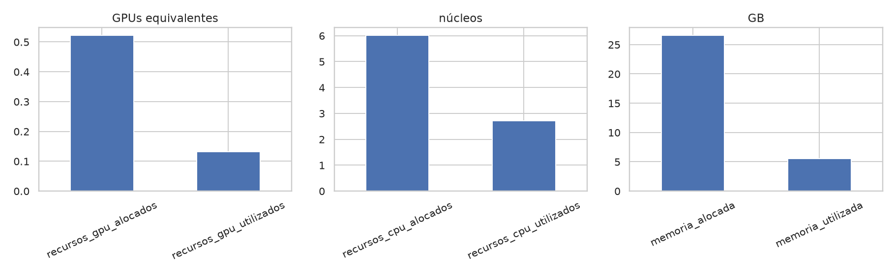
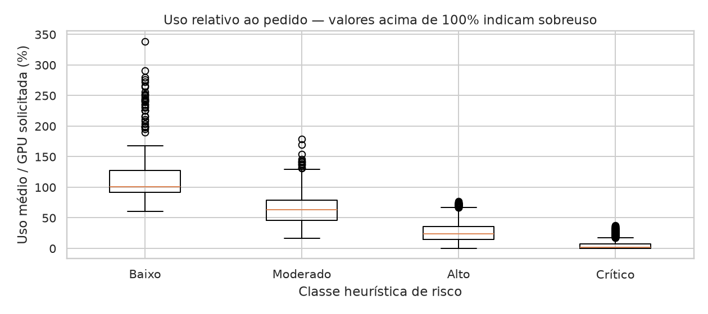
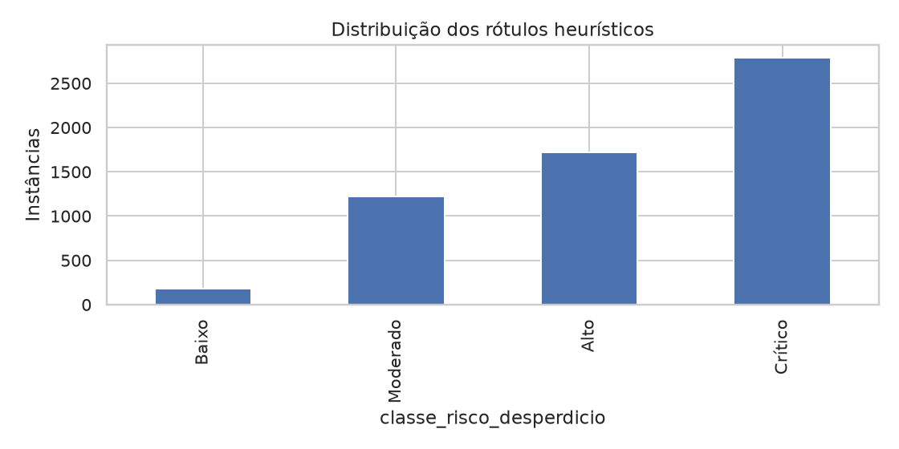
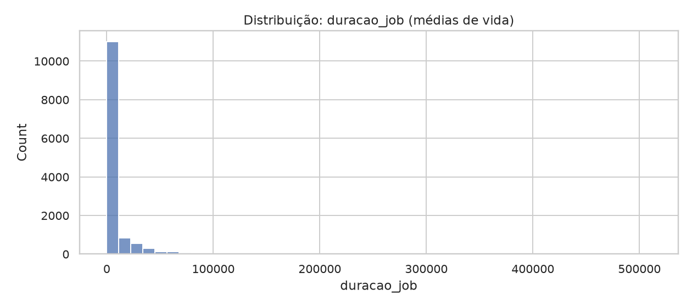
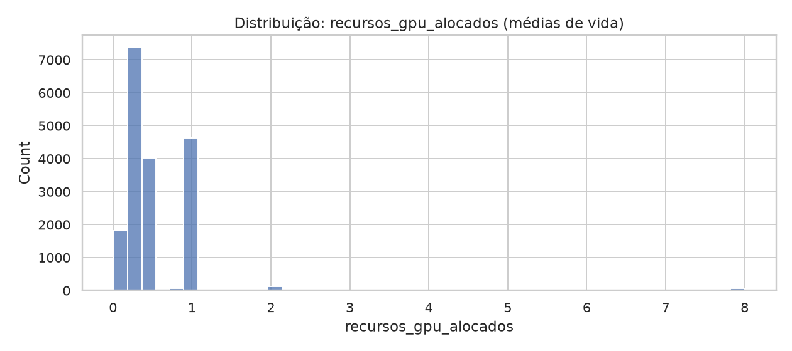
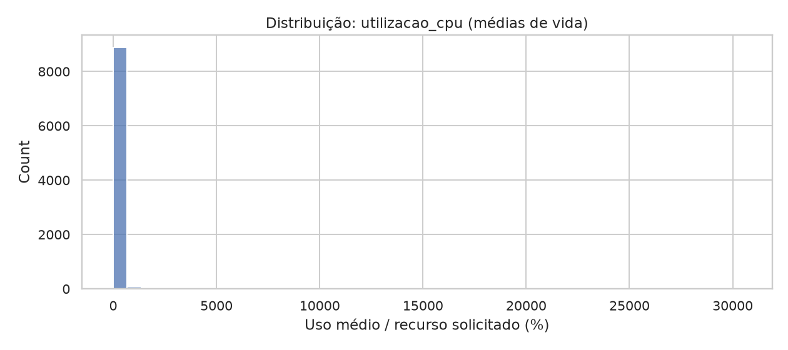
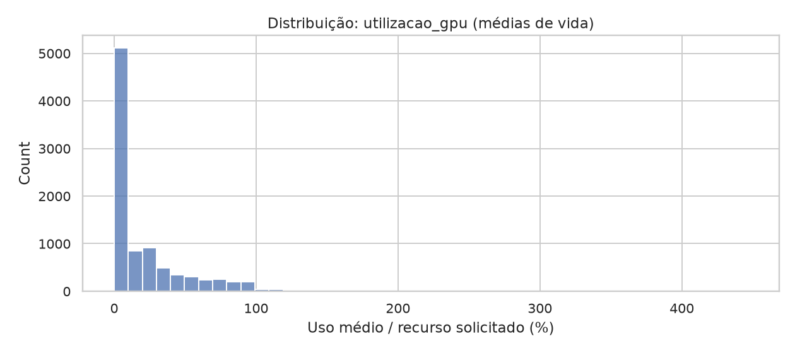
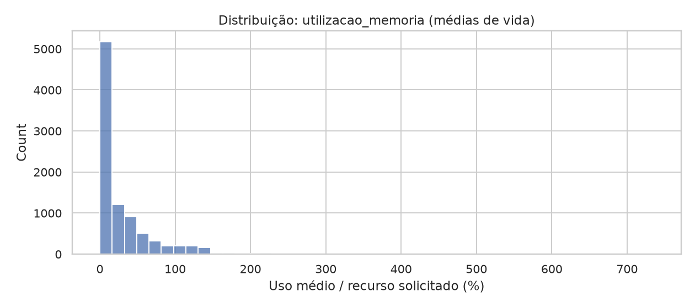
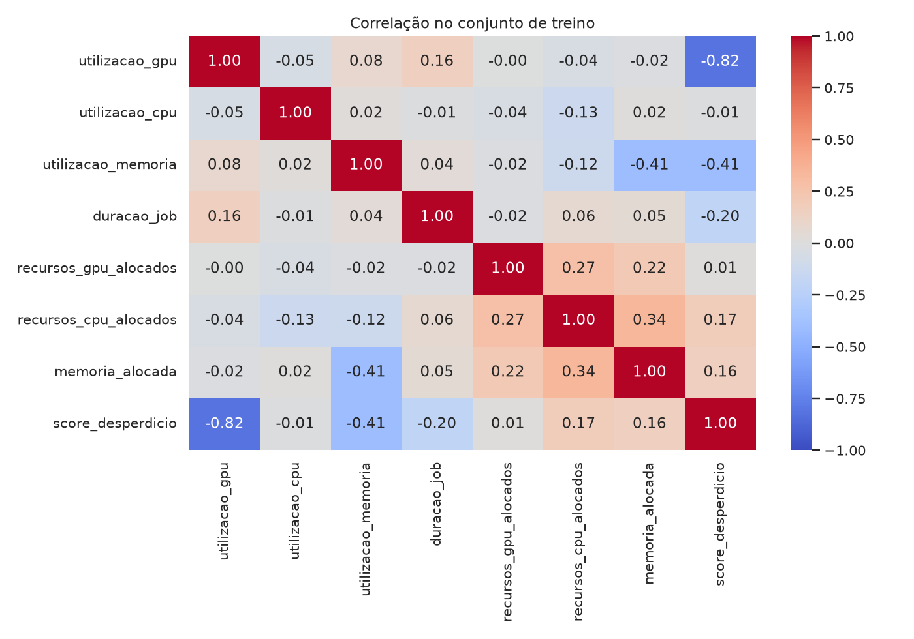
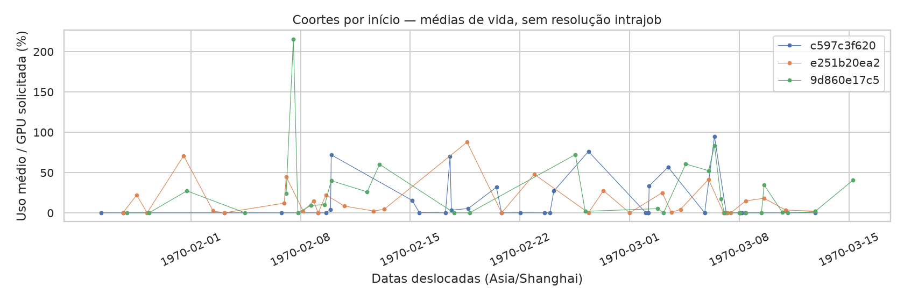

# Relatório de qualidade — Alibaba GPU v2020

**Rótulo heurístico de recursos; não é medição de energia ou risco ambiental validado.**

Fração de jobs selecionados por hash: 0.30%; seed=42.
Base final: 20,934 linhas, 92 colunas. Unidade: instância durante sua vida observada.
Instâncias antes da integração: 22,704; depois: 20,934.
Período fictício: ['1970-01-12 10:55:32+08:00', '1970-03-16 23:48:10+08:00'] (Asia/Shanghai).
Sem rótulo: 15031; mantidos para auditoria.

Motivos: {'intervalo_ambiguo_ou_invalido': 7802, 'medicao_ausente': 5423, 'pedido_gpu_ausente_ou_nao_positivo': 1806}
Ambiguidades e quarentena: {'instancias': {'duplicatas_exatas_removidas': 0, 'linhas_conflitantes': 1764, 'identidades_ambiguas': 98, 'quarentena': './resultados/quarentena/instancias.parquet', 'quarentena_chaves_nulas': './resultados/quarentena/instancias_chaves_nulas.parquet', 'linhas_originais_chaves_nulas': 1713}, 'tarefas': {'duplicatas_exatas_removidas': 0, 'linhas_conflitantes': 0}}

## Classes

- Baixo: 180
- Moderado: 1,220
- Alto: 1,715
- Crítico: 2,788

## Fontes e integrações

- pai_sensor_table: 3,033,232 linhas lidas; 9,058 na seleção.
- pai_instance_table: 7,522,002 linhas lidas; 22,704 na seleção.
- pai_task_table: 1,261,050 linhas lidas; 3,712 na seleção.
- pai_group_tag_table: 1,055,032 linhas lidas; 3,084 na seleção.
- pai_machine_spec: 1,897 linhas lidas; 1,897 na seleção.
- pai_job_table: 1,055,501 linhas lidas; 3,087 na seleção.
- pai_machine_metric: 2,009,423 linhas lidas; 5,926 na seleção.

Joins auditados: `{"instancias": {"duplicatas_exatas_removidas": 0, "chaves_nulas_quarentena": 104}, "sensores": {"duplicatas_exatas_removidas": 0, "chaves_nulas_quarentena": 0, "chaves": ["job_name", "task_name", "worker_name", "inst_id", "machine"], "tipo": "left", "cardinalidade": "many_to_one", "sem_correspondencia": 11888}, "tarefas": {"duplicatas_exatas_removidas": 0, "chaves_nulas_quarentena": 0, "chaves": ["job_name", "task_name"], "tipo": "left", "cardinalidade": "many_to_one", "sem_correspondencia": 0}, "maquinas": {"duplicatas_exatas_removidas": 0, "chaves_nulas_quarentena": 0, "chaves": ["machine"], "tipo": "left", "cardinalidade": "many_to_one", "sem_correspondencia": 0}, "tags": {"duplicatas_exatas_removidas": 0, "chaves_nulas_quarentena": 0, "chaves": ["inst_id"], "tipo": "left", "cardinalidade": "many_to_one", "sem_correspondencia": 5}}`

## Treino e validação

Divisão: {'metodo': 'temporal', 'purgados': 4, 'contagens': {'sem_rotulo': 15031, 'treino': 4024, 'teste': 972, 'validacao': 903, 'purgado': 4}, 'classes_por_conjunto': {'Alto': {'purgado': 1, 'teste': 217, 'treino': 1175, 'validacao': 322}, 'Baixo': {'purgado': 0, 'teste': 21, 'treino': 145, 'validacao': 14}, 'Crítico': {'purgado': 2, 'teste': 480, 'treino': 1874, 'validacao': 432}, 'Moderado': {'purgado': 1, 'teste': 254, 'treino': 830, 'validacao': 135}}, 'observacao': 'Proporções aproximadas: grupos e fronteiras temporais têm precedência.'}
Remoção de constantes: []
Remoção de redundantes: []
Preditores: ['recursos_cpu_alocados', 'recursos_gpu_alocados', 'memoria_alocada', 'hora_do_dia', 'dia_da_semana', 'fim_de_semana', 'indicador_pico', 'task_name', 'gpu_type', 'turno']
Imputação, escala, seleção, outliers e correlações ajustados só no treino.
class_weight=balanced no baseline. Classes heurísticas não constituem validação ambiental.

## Limitações

Médias de vida não permitem reconstruir janelas de atividade, médias móveis de 15min, variação de 1h ou simultaneidade.
Percentuais são relativos ao pedido. Valores acima de 100% são preservados e sinalizados.
Não há identificação de rack, potência, kWh, temperatura ou refrigeração. Ausência não equivale a ociosidade.
A amostra por jobs preserva observações relacionadas, mas não garante representatividade por máquina/tipo raro.
Outliers são sinalizados, não removidos. Picos podem ser normais em IA.
Estatísticas descritivas das fontes são da seleção; linhas totais resultam da leitura completa.
Consulte relatorio_qualidade.json para nulos, tipos, memória, categorias, duplicatas, outliers e limiares.
Consulte DECISOES.md para schema, unidades e justificativas.

## Algoritmos sugeridos

Random Forest é o baseline incluído. Compare XGBoost/LightGBM para interações tabulares; SVM para amostras menores escalonadas.
Valide limiares com especialistas e dados de potência antes de interpretar previsões como impacto ambiental.

## Gráficos

